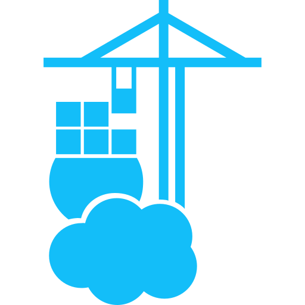

<p align="center">
  <picture>
    <source media="(prefers-color-scheme: dark)" srcset="assets/icon-dark.svg">
    
  </picture>
</p>

<h1 align="center">aac-portainer</h1>

<p align="center">Self-hosted deployment definition for Portainer Server, a container management UI.</p>

<p align="center">
  <a href="https://github.com/portainer/portainer"></a>
  
  <a href="https://github.com/portainer/portainer/blob/develop/LICENSE"></a>
</p>

## About

Portainer is a lightweight management UI for Docker, Swarm, Kubernetes and Podman
environments. It lets you deploy, inspect and manage containers, images, networks, volumes
and stacks from a web browser, without writing Compose files or CLI commands by hand.

Key features (as provided by upstream):

- Web UI for managing containers, images, networks, volumes and stacks
- Support for Docker, Docker Swarm, Kubernetes and Podman environments
- Role-based access control and multi-user support
- Templates for deploying applications with a few clicks
- Container logs, console access and resource statistics

## Upstream

- Project: <https://github.com/portainer/portainer>
- Website: <https://www.portainer.io>
- Documentation: <https://docs.portainer.io>
- Container image: `portainer/portainer-ce:2.43.0`
- License: zlib (upstream project)

## Quick start (Docker Compose)

The Compose file is rendered from `service.yml` by the App-as-Code template engine. For a
manual run, the external network used for Traefik routing must exist first:

```bash
docker network create services-secured

docker compose up -d
```

No secrets are required for this service. The container mounts the host Docker socket
(`/var/run/docker.sock`) to manage containers, so it must run on a host you trust.

## Configuration

Environment variables (defaults from `service.yml`):

| Variable | Default | Description |
|---|---|---|
| `PUID` | `1000` | User ID the container runs as |
| `PGID` | `1000` | Group ID the container runs as |
| `TZ` | `Europe/Berlin` | Time zone |

Ports:

| Container port | Protocol | Purpose | Published port |
|---|---|---|---|
| `9443` | TCP | Web UI and API over HTTPS (`web`) | `9222` |
| `8000` | TCP | Edge agent tunnel (`edge`) | `8000` |
| `9000` | TCP | Legacy HTTP API and UI (`legacy-api`, routed by Traefik) | `9111` |

Volumes:

| Mount | Description |
|---|---|
| `data` -> `/data` | Persistent Portainer data (users, settings, stacks) |
| `/var/run/docker.sock` -> `/var/run/docker.sock` | Host Docker socket used for container management (bind mount) |

## Deploy with App-as-Code

1. Edit `service.yml`. It is the single source of truth for image, ports, environment,
   volumes, dependencies and per-stage overrides. Do not edit the rendered output.
2. Pushing to `main` (or a configured stage branch) runs the service pipeline, which renders
   the manifests with `aac-template-engine` and triggers the deployment.
3. Releases of this definition are published under <https://github.com/app-as-code/aac-portainer>.

## Credits and license

Portainer is developed by the Portainer project and licensed under the zlib license. This
repository only contains the deployment definition for it and is not a fork of the
application. The logo is provided by the Portainer project; see [`assets/ICON_SOURCE.md`](assets/ICON_SOURCE.md)
for icon sources and licenses.
